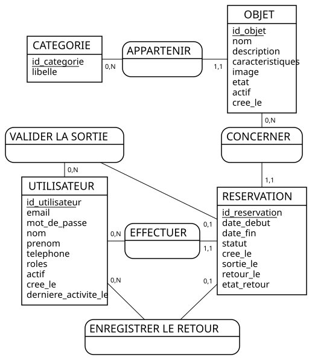

# Modèle conceptuel de données (MCD)

Ticket : [#1 J2-A1 MCD](https://github.com/IamArayel/MSP2-PretOutil/issues/1) · Méthode : Merise · Source : [mcd.mcd](mcd.mcd) (Mocodo 4.3)

Le MCD couvre les données relationnelles stockées dans PostgreSQL. Le journal d'audit (RG8) est stocké dans MongoDB et n'apparaît pas dans le MCD (voir [Hors MCD](#hors-mcd-journal-daudit)).

## 1. Entités

| Entité | Identifiant | Description |
|---|---|---|
| UTILISATEUR | `id_utilisateur` | Personne inscrite : adhérent, gestionnaire ou administrateur |
| CATEGORIE | `id_categorie` | Famille d'objets (Outillage, Camping, Audiovisuel...) |
| OBJET | `id_objet` | Article physique prêté par l'association (1 objet = 1 article) |
| RESERVATION | `id_reservation` | Emprunt d'un objet par un adhérent sur une période, de la réservation au retour |

## 2. Associations et cardinalités

| Association | Lecture dans un sens | Lecture dans l'autre sens |
|---|---|---|
| APPARTENIR | Un objet appartient à **une et une seule** catégorie (1,1) | Une catégorie regroupe **zéro ou plusieurs** objets (0,N) |
| CONCERNER | Une réservation concerne **un et un seul** objet (1,1) | Un objet est concerné par **zéro ou plusieurs** réservations (0,N) |
| EFFECTUER (rôle adhérent) | Une réservation est effectuée par **un et un seul** utilisateur (1,1) | Un utilisateur effectue **zéro ou plusieurs** réservations (0,N) |
| VALIDER LA SORTIE (rôle gestionnaire) | Une réservation est sortie par **au plus un** gestionnaire (0,1) | Un gestionnaire valide **zéro ou plusieurs** sorties (0,N) |
| ENREGISTRER LE RETOUR (rôle gestionnaire) | Une réservation est rendue auprès d'**au plus un** gestionnaire (0,1) | Un gestionnaire enregistre **zéro ou plusieurs** retours (0,N) |

La cardinalité 0,1 côté RESERVATION traduit le cycle de vie : une réservation confirmée n'a encore ni sortie ni retour.

## 3. Attributs à valeurs contrôlées

| Entité.attribut | Valeurs possibles | Règle |
|---|---|---|
| UTILISATEUR.roles | `ROLE_USER`, `ROLE_MANAGER`, `ROLE_ADMIN` | Hiérarchie des rôles (cahier des charges, section 5) |
| UTILISATEUR.actif | vrai, faux | RG9 |
| OBJET.etat | `bon`, `abime`, `hors_service` | RG5, RG7 |
| OBJET.actif | vrai, faux | US6 (suppression logique) |
| RESERVATION.statut | `confirmee`, `en_cours`, `terminee`, `annulee` | Cycle de vie (cahier des charges, section 6.3) |
| RESERVATION.etat_retour | `bon`, `abime`, `hors_service` | US8, RG7 |

## 4. Couverture des besoins

Chaque user story et chaque règle de gestion trouve les données dont elle a besoin.

| Besoin | Données utilisées |
|---|---|
| US1 Créer un compte | UTILISATEUR (email unique, mot_de_passe, nom, prenom, telephone) |
| US2 Se connecter | UTILISATEUR.email, mot_de_passe, actif |
| US3 Catalogue filtré | OBJET, CATEGORIE (APPARTENIR) ; disponibilité calculée à partir de RESERVATION (dates, statut) |
| US4 Réserver | RESERVATION + EFFECTUER + CONCERNER |
| US5 Mes réservations, annuler | RESERVATION.statut via EFFECTUER |
| US6 Gérer le catalogue | OBJET, OBJET.actif |
| US7 Valider la sortie | RESERVATION.sortie_le, statut + VALIDER LA SORTIE |
| US8 Enregistrer le retour | RESERVATION.retour_le, etat_retour, statut + ENREGISTRER LE RETOUR ; OBJET.etat |
| US9 Gérer les comptes | UTILISATEUR.roles, actif |
| US10 Journal d'audit | MongoDB (hors MCD) |
| RG1 Dates cohérentes | RESERVATION.date_debut, date_fin |
| RG2 Pas de chevauchement | RESERVATION.date_debut, date_fin, statut + CONCERNER |
| RG3 14 jours maximum | RESERVATION.date_debut, date_fin |
| RG4 3 réservations actives maximum | RESERVATION.statut via EFFECTUER |
| RG5 Objet non réservable | OBJET.etat, actif |
| RG6 Annulation jusqu'à la veille | RESERVATION.date_debut, statut |
| RG7 Retour hors service | RESERVATION.etat_retour, OBJET.etat |
| RG8 Journalisation | MongoDB (hors MCD) |
| RG9 Compte désactivé | UTILISATEUR.actif |
| RGPD (conservation 3 ans) | UTILISATEUR.derniere_activite_le |

## 5. Choix de conception

| Choix | Alternative écartée | Justification |
|---|---|---|
| RESERVATION est une **entité**, pas une association porteuse entre UTILISATEUR et OBJET | Association RÉSERVER (UTILISATEUR, OBJET) avec dates | Un même adhérent peut réserver plusieurs fois le même objet : le couple (utilisateur, objet) ne suffit pas à identifier une réservation. Il faut un identifiant propre. |
| Sortie et retour portés par RESERVATION (`sortie_le`, `retour_le`, `etat_retour`) | Entité PRÊT séparée | Relation 1-1 avec la réservation : une entité séparée ajouterait une jointure sans apporter d'information. Le cycle de vie complet reste au même endroit. |
| Rôles stockés dans un attribut `roles` d'UTILISATEUR | Entité RÔLE + association | Trois rôles fixes, connus à l'avance et hiérarchisés : c'est la convention de Symfony Security (`getRoles()`). Une entité RÔLE n'apporterait rien au MVP. |
| Disponibilité d'un objet **calculée** à partir des réservations | Attribut `disponible` dans OBJET | Une donnée calculée stockée risque de devenir incohérente. Le statut affiché au catalogue est déduit des réservations actives et de `OBJET.etat`. |
| Deux associations distinctes pour la sortie et le retour | Une seule association « gérer » | Ce ne sont pas forcément les mêmes gestionnaires ; la traçabilité exige de savoir qui a fait quoi. |

## Hors MCD : journal d'audit

Le journal d'audit (RG8, US10) est une collection MongoDB `audit_log`. Il n'est pas modélisé en Merise car :

- il ne participe à aucune jointure : on l'écrit, on le lit, on ne le modifie jamais ;
- son contenu (`details`) change de forme selon l'action ;
- il doit rester lisible même si une donnée relationnelle est supprimée, il recopie donc les informations utiles (email de l'acteur, nom de l'objet) au lieu de les référencer.

Sa structure est décrite avec le MPD (ticket [#2](https://github.com/IamArayel/MSP2-PretOutil/issues/2)).

## Vers le MLD

Le MLD généré par Mocodo (`mocodo --input mcd.mcd -t mld`) donne :

- **CATEGORIE** (<u>id_categorie</u>, libelle)
- **OBJET** (<u>id_objet</u>, nom, description, caracteristiques, etat, actif, cree_le, _#id_categorie_)
- **RESERVATION** (<u>id_reservation</u>, date_debut, date_fin, statut, cree_le, sortie_le, retour_le, etat_retour, _#id_utilisateur adhérent_, _#id_objet_, _#id_utilisateur gestionnaire 1_, _#id_utilisateur gestionnaire 2_)
- **UTILISATEUR** (<u>id_utilisateur</u>, email, mot_de_passe, nom, prenom, telephone, roles, actif, cree_le, derniere_activite_le)

Les rôles nomment les trois clés étrangères vers UTILISATEUR. Au MPD (ticket #2), elles deviendront `utilisateur_id`, `sortie_par_id` et `retour_par_id`, selon les conventions de nommage du ticket #3.
