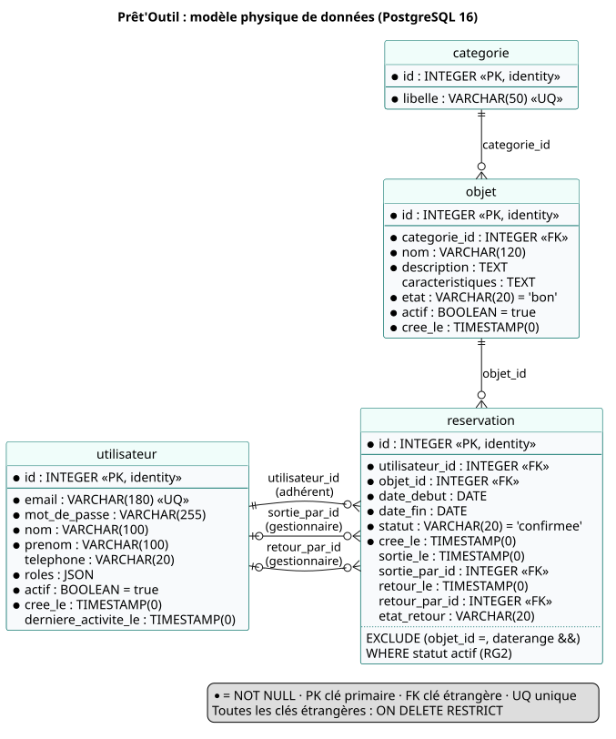

# Modèle logique et modèle physique de données (MLD / MPD)

Ticket : [#2 J2-A2 MLD / MPD et contrainte anti-chevauchement](https://github.com/IamArayel/MSP2-PretOutil/issues/2) · Issu du [MCD](mcd.md)

| Fichier | Rôle |
|---|---|
| [mpd.sql](mpd.sql) | Script de création PostgreSQL 16 : tables, contraintes, index, droits |
| [mpd_tests.sql](mpd_tests.sql) | Jeu d'essai des contraintes PostgreSQL (21 cas) |
| [audit_log.mongodb.js](audit_log.mongodb.js) | Collection MongoDB du journal d'audit : validateur, index, rôle |
| [audit_log_tests.mongodb.js](audit_log_tests.mongodb.js) | Jeu d'essai du validateur MongoDB (8 cas) |
| [mpd.puml](mpd.puml) | Source du diagramme ci-dessous |

## 1. MLD

Règles de passage appliquées : une association (1,1) devient une clé étrangère obligatoire ; une association (0,1) devient une clé étrangère facultative ; les rôles du MCD nomment les clés étrangères vers la même table.

- **utilisateur** (<u>id</u>, email, mot_de_passe, nom, prenom, telephone, roles, actif, cree_le, derniere_activite_le)
- **categorie** (<u>id</u>, libelle)
- **objet** (<u>id</u>, nom, description, caracteristiques, image, etat, actif, cree_le, _#categorie_id_)
- **reservation** (<u>id</u>, date_debut, date_fin, statut, cree_le, sortie_le, retour_le, etat_retour, _#utilisateur_id_, _#objet_id_, _#sortie_par_id_, _#retour_par_id_)

| Association du MCD | Clé étrangère | Obligatoire |
|---|---|---|
| APPARTENIR | `objet.categorie_id` → `categorie.id` | Oui (1,1) |
| CONCERNER | `reservation.objet_id` → `objet.id` | Oui (1,1) |
| EFFECTUER (adhérent) | `reservation.utilisateur_id` → `utilisateur.id` | Oui (1,1) |
| VALIDER LA SORTIE (gestionnaire) | `reservation.sortie_par_id` → `utilisateur.id` | Non (0,1) |
| ENREGISTRER LE RETOUR (gestionnaire) | `reservation.retour_par_id` → `utilisateur.id` | Non (0,1) |

## 2. MPD



## 3. Contraintes et règles de gestion

| Contrainte | Table | Garantit |
|---|---|---|
| `ex_reservation_chevauchement` | reservation | **RG2** : deux réservations actives (`confirmee`, `en_cours`) d'un même objet ne se chevauchent pas. Bornes incluses : un objet rendu le 20 n'est pas réservable à partir du 20. |
| `ck_reservation_dates` | reservation | **RG1** : date de fin postérieure ou égale à la date de début |
| `ck_reservation_cycle_de_vie` | reservation | Le statut est cohérent avec la sortie et le retour (cycle de vie du cahier des charges, section 6.3) |
| `ck_reservation_sortie` | reservation | Une sortie a toujours une date **et** un gestionnaire (US7, traçabilité) |
| `ck_reservation_retour` | reservation | Un retour a une date, un gestionnaire **et** un état (US8) |
| `ck_reservation_retour_apres_sortie` | reservation | Pas de retour sans sortie, ni avant elle |
| `ck_reservation_statut`, `ck_reservation_etat_retour`, `ck_objet_etat` | reservation, objet | Valeurs contrôlées (voir [MCD, section 3](mcd.md#3-attributs-à-valeurs-contrôlées)) |
| `uq_utilisateur_email`, `ck_utilisateur_email_minuscules` | utilisateur | US1 : email unique, sans doublon par variante de casse |
| `uq_categorie_libelle` | categorie | Pas de catégorie en double |
| `fk_*` en `ON DELETE RESTRICT` | toutes | Intégrité référentielle : on ne supprime pas une donnée référencée (US6 : suppression logique via `actif`) |

**Règles laissées au service métier** (et pourquoi) :

| Règle | Raison |
|---|---|
| RG1 « pas dans le passé » | Dépend de la date du jour : une contrainte `CHECK` doit être immuable, et une réservation passée deviendrait invalide le lendemain. |
| RG3 « 14 jours maximum » | Paramètre métier susceptible d'évoluer ; il reste dans le code (une constante) plutôt que figé dans le schéma. |
| RG4 « 3 réservations actives » | Comptage sur plusieurs lignes, hors de portée d'un `CHECK` ; indexé par `idx_reservation_utilisateur_statut`. |
| RG5, RG6, RG7, RG9 | Règles de comportement, contrôlées par `ReservationService`, les Voters et le `UserChecker`. |

## 4. Choix techniques

| Choix | Alternative écartée | Justification |
|---|---|---|
| `VARCHAR(20)` + `CHECK` pour les valeurs contrôlées | Type `ENUM` PostgreSQL | Correspond au mapping des enums PHP par Doctrine ; ajouter une valeur se fait par simple migration, sans `ALTER TYPE`. |
| `INTEGER GENERATED BY DEFAULT AS IDENTITY` | `SERIAL`, UUID | Norme SQL, stratégie `IDENTITY` de Doctrine ; un entier suffit au volume de l'association. |
| `TIMESTAMP(0)` sans fuseau, en UTC | `TIMESTAMPTZ` | Type par défaut de Doctrine (`datetime_immutable`) ; l'application fixe le fuseau UTC. |
| `DATE` pour les périodes | `TIMESTAMP` | Une réservation se fait à la journée ; `daterange` s'appuie dessus pour RG2. |
| `roles` en `JSON` | Table de rôles | Convention Symfony Security (voir [MCD, choix de conception](mcd.md#5-choix-de-conception)). |
| Contrainte d'exclusion `EXCLUDE USING gist` | Vérification seule dans le code | **Défense en profondeur** : même deux requêtes simultanées ne peuvent pas créer un chevauchement (le service ne le voit pas, la base le refuse). Nécessite l'extension `btree_gist`. |

## 5. Index

| Index | Usage |
|---|---|
| `idx_objet_categorie` | Filtre du catalogue par catégorie (US3) |
| `idx_reservation_utilisateur_statut` | Mes réservations (US5), comptage des réservations actives (RG4) |
| `idx_reservation_objet` | Disponibilité d'un objet (US3, US4) |
| `idx_reservation_sortie_par`, `idx_reservation_retour_par` | Clés étrangères (suppression contrôlée d'un compte) |
| Index GiST de `ex_reservation_chevauchement` | Créé automatiquement, sert aussi aux recherches de disponibilité sur une période |

## 6. Sécurité et confidentialité

- **Droits minimaux** : l'application se connecte avec le rôle `pretoutil_app` (`SELECT`, `INSERT`, `UPDATE` ; `DELETE` uniquement sur `objet`), jamais avec le propriétaire du schéma. Mots de passe des rôles hors du dépôt.
- **Mots de passe des comptes** : seule l'empreinte est stockée (`mot_de_passe`, hasher Symfony `auto`).
- **RGPD** : données personnelles limitées à `nom`, `prenom`, `email`, `telephone` ; `derniere_activite_le` sert de point de départ à la durée de conservation de 3 ans. Une demande de suppression se traite par anonymisation (les réservations restent pour l'historique, les clés étrangères sont en `RESTRICT`).

## 7. MongoDB : collection `audit_log`

Un document par action sensible (RG8) :

```json
{
  "horodatage": { "$date": "2026-12-07T10:42:00Z" },
  "action": "RETOUR_ENREGISTRE",
  "acteur": { "id": 2, "email": "lea.bernard@exemple.fr" },
  "cible": { "type": "reservation", "id": 128 },
  "details": { "objet": "Réchaud à gaz", "etat_retour": "abime" }
}
```

| Élément | Choix |
|---|---|
| Validateur `$jsonSchema` (`validationAction: error`) | Champs obligatoires, liste fermée des 13 actions et des 3 types de cible, aucun champ imprévu (`additionalProperties: false`). Seul `details` est libre : c'est ce qui justifie MongoDB. |
| `acteur.email` recopié | Le journal reste lisible même si le compte est modifié ou anonymisé. |
| Index `idx_action_horodatage` | Filtre par type d'action trié par date (US10). |
| Index TTL `ttl_horodatage_1an` | Suppression automatique après 1 an (RGPD : durée de conservation des journaux). |
| Rôle `auditAppendOnly` | `find` et `insert` seulement : l'application ne peut ni modifier ni effacer le journal. |

## 8. Jeu d'essai

Exécuté le 2026-11-23 sur des conteneurs `postgres:16-alpine` et `mongo:8.0`, versions de l'environnement Docker du projet. Un premier passage sur PostgreSQL 17 donnait le même résultat.

### PostgreSQL : 21 cas, 21 conformes

| N° | Cas | Attendu | Obtenu |
|---|---|---|---|
| 1 | Réservation valide, objet 1, 12/12 au 14/12 | accepté | accepté |
| 2 | Chevauchement, objet 1, 13/12 au 15/12 | refusé (ex_reservation_chevauchement) | refusé (ex_reservation_chevauchement) |
| 3 | Début le jour de fin d'une autre, objet 1, 14/12 au 16/12 | refusé (ex_reservation_chevauchement) | refusé (ex_reservation_chevauchement) |
| 4 | Période suivante, objet 1, 15/12 au 16/12 | accepté | accepté |
| 5 | Même période sur un autre objet | accepté | accepté |
| 6 | Réservation annulée, objet 1, 20/12 au 22/12 | accepté | accepté |
| 7 | Période d'une réservation annulée, objet 1, 21/12 au 23/12 | accepté | accepté |
| 8 | Date de fin avant la date de début | refusé (ck_reservation_dates) | refusé (ck_reservation_dates) |
| 9 | Statut inconnu | refusé (ck_reservation_cycle_de_vie) | refusé (ck_reservation_cycle_de_vie) |
| 10 | État d'objet inconnu | refusé (ck_objet_etat) | refusé (ck_objet_etat) |
| 11 | Statut en cours sans sortie | refusé (ck_reservation_cycle_de_vie) | refusé (ck_reservation_cycle_de_vie) |
| 12 | Sortie sans gestionnaire | refusé (ck_reservation_sortie) | refusé (ck_reservation_sortie) |
| 13 | Sortie complète (date + gestionnaire) | accepté | accepté |
| 14 | Retour sans état | refusé (ck_reservation_retour) | refusé (ck_reservation_retour) |
| 15 | Retour avant la sortie | refusé (ck_reservation_retour_apres_sortie) | refusé (ck_reservation_retour_apres_sortie) |
| 16 | Email en majuscules | refusé (ck_utilisateur_email_minuscules) | refusé (ck_utilisateur_email_minuscules) |
| 17 | Email déjà utilisé | refusé (uq_utilisateur_email) | refusé (uq_utilisateur_email) |
| 18 | Supprimer une catégorie qui contient des objets | refusé (fk_objet_categorie) | refusé (fk_objet_categorie) |
| 19 | Supprimer un objet déjà réservé | refusé (fk_reservation_objet) | refusé (fk_reservation_objet) |
| 20 | Droit DELETE de `pretoutil_app` sur reservation | refusé | refusé |
| 21 | Droit INSERT de `pretoutil_app` sur reservation | accepté | accepté |

### Écarts constatés au premier passage et corrections

| Cas | Écart | Analyse | Correction |
|---|---|---|---|
| 9 Statut inconnu | Refusé par `ck_reservation_cycle_de_vie` au lieu de `ck_reservation_statut` | Un statut inconnu viole les deux contraintes. PostgreSQL évalue les `CHECK` dans l'ordre alphabétique de leur nom et signale la première violée. Le comportement est correct, l'attendu était trop précis. | Attendu corrigé ; les deux contraintes sont conservées (`ck_reservation_statut` documente les valeurs autorisées). |
| 17 Email déjà utilisé | Refusé par `pk_utilisateur` au lieu de `uq_utilisateur_email` | Le jeu de données insérait des `id` explicites : la séquence d'identité n'avance pas et le `INSERT` suivant sans `id` réutilise l'id 1. **Le même problème touchera les fixtures si elles forcent les id.** | Séquences resynchronisées par `setval` après l'insertion des données de départ. À J3 : fixtures sans id explicite. |

### MongoDB : 8 cas, 8 conformes

| Cas | Attendu | Obtenu |
|---|---|---|
| Retour enregistré valide | accepté | accepté |
| Connexion échouée, acteur anonyme (`id: null`) | accepté | accepté |
| Identifiant en entier 64 bits | accepté | accepté |
| Action inconnue | refusé | refusé (121) |
| Horodatage en texte | refusé | refusé (121) |
| Acteur sans email | refusé | refusé (121) |
| Champ non prévu | refusé | refusé (121) |
| Type de cible inconnu | refusé | refusé (121) |

Code 121 : `DocumentValidationFailure`. Le cas « entier 64 bits » a été ajouté après analyse : selon le pilote, un identifiant PHP peut être encodé en `int` ou en `long` ; le validateur accepte les deux.

### Reproduire les tests

```bash
docker run -d --rm --name pretoutil-test-pg -e POSTGRES_PASSWORD=test -e POSTGRES_DB=pretoutil postgres:16-alpine
docker exec -i pretoutil-test-pg psql -v ON_ERROR_STOP=1 -U postgres -d pretoutil < docs/conception/mpd.sql
docker exec -i pretoutil-test-pg psql -v ON_ERROR_STOP=1 -U postgres -d pretoutil < docs/conception/mpd_tests.sql
```

```bash
docker run -d --rm --name pretoutil-test-mongo mongo:8.0
docker exec -i pretoutil-test-mongo mongosh --quiet pretoutil < docs/conception/audit_log.mongodb.js
docker cp docs/conception/audit_log_tests.mongodb.js pretoutil-test-mongo:/tmp/tests.js
docker exec pretoutil-test-mongo mongosh --quiet pretoutil /tmp/tests.js
```

```bash
docker stop pretoutil-test-pg pretoutil-test-mongo
```

## 9. Points de vigilance pour J3 (Doctrine)

1. **Migrations** : Doctrine génère les tables, clés et index, mais pas les `CHECK`, ni l'extension `btree_gist`, ni la contrainte `EXCLUDE`. Ils sont recopiés depuis `mpd.sql` dans une migration écrite à la main.
2. **Index de la contrainte `EXCLUDE`** : Doctrine pourrait le voir comme un index inconnu et proposer de le supprimer au prochain `make:migration`. À vérifier dès la première migration et à exclure du diff si besoin. **Confirmé et traité, voir section 10.**
3. **Fixtures** : ne pas forcer les `id` (voir l'écart du cas 17).
4. **Noms des contraintes** : Doctrine nomme ses clés et index avec des empreintes (`IDX_...`, `FK_...`). Les noms lisibles de `mpd.sql` servent au dossier ; on ne cherchera pas à les imposer à Doctrine.

## 10. Base créée par les migrations Doctrine (J3)

Ticket : [#18 J3-A2 Migrations avec contraintes CHECK et EXCLUDE](https://github.com/IamArayel/MSP2-PretOutil/issues/18)

Le schéma de l'application est créé par deux migrations, dans `migrations/` :

| Migration | Contenu | Origine |
|---|---|---|
| `Version20261123095227` | Tables, clés primaires et étrangères, index | Générée par `doctrine:migrations:diff` à partir des entités |
| `Version20261123095233` | Extension `btree_gist`, 9 contraintes `CHECK`, contrainte `EXCLUDE` | Écrite à la main, recopiée de `mpd.sql` |

### Index de la contrainte `EXCLUDE` (point de vigilance 2)

Confirmé à la première migration : Doctrine lit l'index qui porte `ex_reservation_chevauchement` comme un index ordinaire et proposait de le supprimer puis de le recréer, ce qui aurait supprimé la contrainte. L'écouteur `App\Doctrine\IndexChevauchementListener` déclare cet index dans le schéma attendu par Doctrine. Depuis, `doctrine:migrations:diff` ne détecte aucun changement et `doctrine:schema:validate` est vert.

Conséquence : le schéma se crée uniquement par les migrations. `doctrine:schema:create` et `doctrine:schema:update` ne doivent pas être utilisés, car ils créeraient un index ordinaire à la place de la contrainte.

Doctrine ne lit pas les contraintes `CHECK` : elles ne provoquent aucun écart.

### Comparaison avec `mpd.sql`

Comparaison automatique des catalogues PostgreSQL d'une base créée par `mpd.sql` et de la base migrée :

| Élément | Résultat |
|---|---|
| Colonnes (nom, type, longueur, obligatoire, défaut) | Identiques ; Doctrine écrit `DEFAULT NULL` explicitement sur les colonnes facultatives, sans effet |
| Contraintes `CHECK` et `EXCLUDE` | Identiques, mêmes noms |
| Clés primaires, étrangères, unicité, index | Mêmes colonnes, noms générés par Doctrine (`utilisateur_pkey`, `FK_...`, `UNIQ_...`, `IDX_...`), comme prévu au point de vigilance 4 ; unicité portée par un index unique au lieu d'une contrainte `UNIQUE`, même effet |
| Index supplémentaire | `IDX_...` sur `reservation.utilisateur_id`, redondant avec `idx_reservation_utilisateur_statut` : conservé, Doctrine indexe chaque clé étrangère |
| Commentaires `COMMENT ON` | Absents : la documentation des colonnes est dans le dictionnaire de données |
| Rôle `pretoutil_app` et droits | Hors migrations : ticket [#22](https://github.com/IamArayel/MSP2-PretOutil/issues/22) |

Les migrations ont aussi été testées dans les deux sens : retour à une base vide (`migrate first`), puis application complète.

### Jeu d'essai sur la base migrée : 19 cas, 19 conformes

Le script `mpd_tests.sql` a été rejoué sur la base migrée, avec deux adaptations faites à l'exécution, sans modifier le fichier :

- les cas 20 et 21 (droits de `pretoutil_app`) sont retirés, le rôle étant créé au ticket #22 ;
- pour les cas 17 à 19, le nom attendu est celui que Doctrine a donné à la contrainte (`UNIQ_1D1C63B3E7927C74`, `FK_46CD4C38BCF5E72D`, `FK_42C84955F520CF5A`).

Les 19 cas donnent le même comportement que sur la base de référence : mêmes acceptations, mêmes refus.
