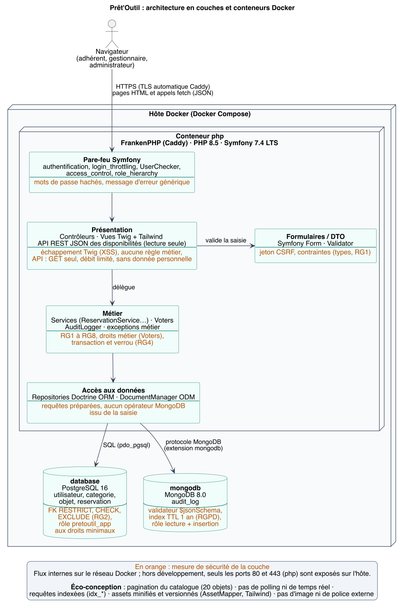

# Architecture multicouche répartie

Ticket : [#8 J2-C2 Schéma d'architecture en couches](https://github.com/IamArayel/MSP2-PretOutil/issues/8)

Source : [architecture.puml](architecture.puml) · Rendu : [SVG](architecture.svg), [PNG](architecture.png)

Ce schéma répond au critère « architecture multicouche répartie sécurisée ». Il montre deux découpages complémentaires :

- **logique** : cinq couches dans l'application Symfony, chacune avec une seule responsabilité ;
- **physique** : trois conteneurs Docker, un par technologie, reliés par le réseau interne de Docker Compose.

Le [diagramme de séquence « Réserver un objet »](sequence-reserver.md) montre ces couches en action sur un cas concret.

## 1. Couches logicielles

Les dépendances vont dans un seul sens, de haut en bas : une couche n'appelle que celle du dessous et ne connaît pas celle du dessus.

| Couche | Composants Symfony | Responsabilité | Mesures de sécurité |
|---|---|---|---|
| Pare-feu | Security (`firewall`, `access_control`, `role_hierarchy`), `login_throttling`, `UserChecker` | Authentifier l'utilisateur et filtrer l'accès aux routes avant tout traitement | Mots de passe hachés (hasher `auto`), blocage après 5 échecs (US2), message d'erreur générique, compte désactivé refusé (RG9) |
| Présentation | Contrôleurs, vues Twig, Tailwind | Recevoir la requête, déléguer, rendre la réponse | Échappement automatique Twig (XSS), aucune règle métier, aucun accès direct aux données |
| Présentation (API) | `DisponibiliteController` (JSON), `ApiExceptionSubscriber`, module JavaScript de E4 | Répondre en JSON à un client qui appelle le service par HTTP (US11) | Méthode `GET` seule, débit limité par adresse IP, paramètres validés, aucune donnée personnelle, erreurs génériques ([api.md](../conception/api.md)) |
| Formulaires / DTO | Symfony Form, Validator | Transporter et valider la saisie | Jeton CSRF, contraintes de type et de longueur, RG1 |
| Métier | Services (`ReservationService`...), Voters, `AuditLogger` | Appliquer les règles de gestion et piloter les transactions | RG1 à RG8, droits métier par Voter (RG6), exceptions métier, verrou pour RG4, journalisation (RG8) |
| Accès aux données | Repositories Doctrine ORM, `DocumentManager` Doctrine ODM | Lire et écrire les données | Requêtes préparées (DQL, QueryBuilder), aucun opérateur MongoDB construit à partir de la saisie |

## 2. Répartition en conteneurs

| Conteneur | Image | Rôle | Exposition |
|---|---|---|---|
| `php` | `dunglas/frankenphp` (PHP 8.5) | Serveur web Caddy et application Symfony 7.4 LTS | Ports 80 et 443 : seul point d'entrée |
| `database` | `postgres:16-alpine` | Données métier : `utilisateur`, `categorie`, `objet`, `reservation` | Réseau Docker uniquement (port ouvert sur l'hôte en développement seulement) |
| `mongodb` | `mongo:8.0` | Journal d'audit `audit_log` | Réseau Docker uniquement (idem) |

Chaque base a son volume Docker : les données survivent à la reconstruction des conteneurs.

**Pourquoi deux bases ?** PostgreSQL garantit l'intégrité des données métier, qui sont relationnelles (clés étrangères, contraintes `CHECK` et `EXCLUDE`, transactions). Le journal d'audit est une suite d'événements dont le contenu `details` change selon l'action : MongoDB le stocke sans table par type d'action, et son index TTL applique la durée de conservation RGPD.

## 3. Sécurité de bout en bout

| Niveau | Mesure |
|---|---|
| Transport | HTTPS obligatoire, certificat géré automatiquement par Caddy |
| Application | Les cinq couches ci-dessus : chaque couche contrôle ce qui la concerne, sans compter sur les autres (défense en profondeur) |
| Données PostgreSQL | Contraintes `FK RESTRICT`, `CHECK`, `EXCLUDE` (RG2) ; rôle applicatif `pretoutil_app` aux droits minimaux ([mpd.md](../conception/mpd.md)) |
| Données MongoDB | Validateur `$jsonSchema` strict ; rôle en lecture et insertion seules ; index TTL d'un an |
| Secrets | Hors du dépôt : `.env.local` et variables d'environnement Docker |

## 4. Besoins d'éco-conception

| Besoin | Mise en œuvre | Effet |
|---|---|---|
| Pagination | Catalogue paginé par 20 objets (US3) | Requêtes et pages légères |
| Pas de polling | Pas de rafraîchissement automatique ni de temps réel : les disponibilités sont calculées à la demande | Aucune requête en tâche de fond |
| Requêtes indexées | Index `idx_*` sur les colonnes filtrées et jointes ([mpd.sql](../conception/mpd.sql)) | Moins de calcul côté base |
| Assets minifiés | AssetMapper et Tailwind compilé et minifié, fichiers versionnés et mis en cache | Moins de données transférées |
| Sobriété | Pas d'image dans le MVP, police système plutôt qu'une police téléchargée | Pages légères, aucune requête vers un service tiers |

## 5. Écarts entre l'environnement actuel et la cible

Le schéma décrit l'architecture cible. Le code de J2 n'en contient encore qu'une partie :

| Écart | Situation actuelle | À faire |
|---|---|---|
| Composant Security | ✅ Résolu à J3-B1 : pare-feu `form_login`, `role_hierarchy`, `login_throttling`, `UtilisateurChecker` | |
| Utilisateur PostgreSQL | ✅ Résolu à J3-C1 : l'application se connecte avec `pretoutil_app` (connexion `default`), les migrations et fixtures avec le propriétaire (connexion `proprietaire`) | |
| Utilisateur MongoDB | ✅ Résolu à J3-C1 : l'application se connecte avec `pretoutil_app` (rôle `auditAppendOnly`) ; le compte root ne sert qu'à l'administration | |
| Variables Mercure | Présentes dans `compose.yaml` (modèle `dunglas/symfony-docker`) | Non utilisées : pas de temps réel dans le MVP |
