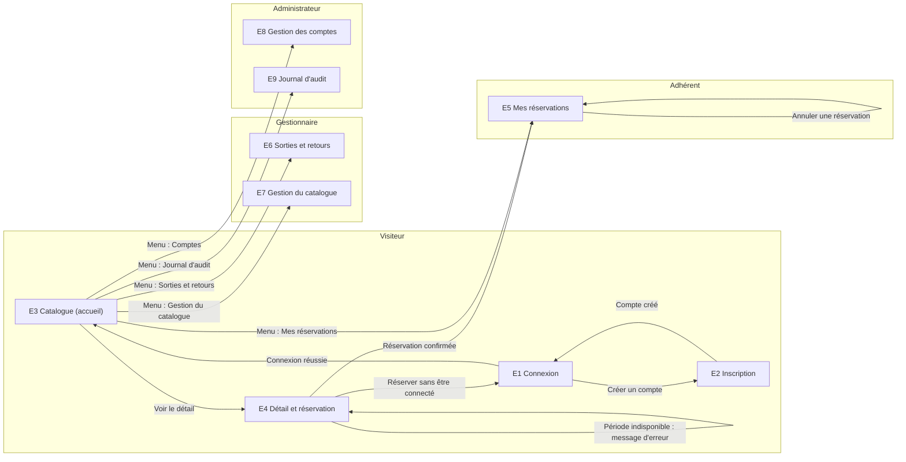

# Enchaînement des écrans

Version éditable dans FigJam : voir le lien dans le [README](../../README.md#maquettes-et-diagrammes).

Chaque rôle a accès aux écrans de son groupe et à ceux des groupes précédents (hiérarchie des rôles). Les liens « Menu » passent par la barre de navigation, qui n'affiche que les entrées autorisées pour le rôle connecté.

| Écran | Maquetté | Remarque |
|---|---|---|
| E1 Connexion | Oui | |
| E2 Inscription | Non | Même structure que E1, avec les champs nom, email, téléphone, mot de passe |
| E3 Catalogue | Oui | |
| E4 Détail et réservation | Oui | Montre le message d'erreur de RG2 |
| E5 Mes réservations | Oui | |
| E6 Sorties et retours | Oui | |
| E7 Gestion du catalogue | Non | Tableau + formulaire, mêmes composants que E5 et E1 |
| E8 Gestion des comptes | Non | Tableau, mêmes composants que E9 |
| E9 Journal d'audit | Oui | |
