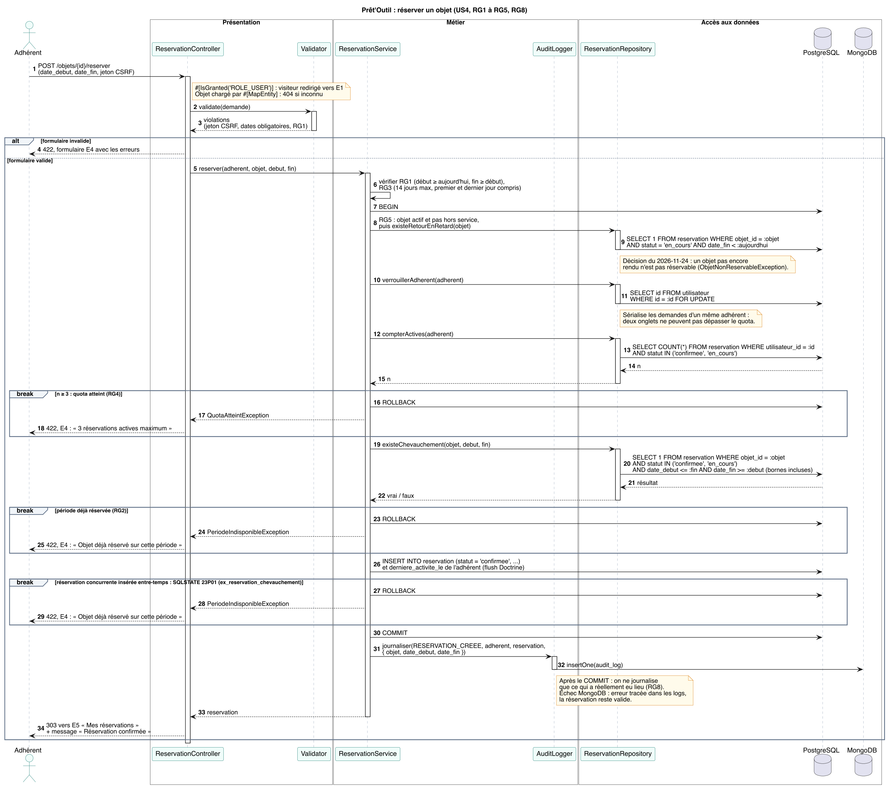

# Diagramme de séquence « Réserver un objet »

Ticket : [#7 J2-C1 Diagramme de séquence « Réserver un objet »](https://github.com/IamArayel/MSP2-PretOutil/issues/7)

Source : [sequence-reserver.puml](sequence-reserver.puml) · Rendu : [SVG](sequence-reserver.svg), [PNG](sequence-reserver.png)

## 1. Pourquoi ce cas

La réservation (US4) est la fonctionnalité la plus représentative de l'application. Elle traverse toutes les couches, applique cinq règles de gestion (RG1 à RG5), écrit dans PostgreSQL et journalise dans MongoDB (RG8).

## 2. Participants par couche

| Couche | Participant | Rôle |
|---|---|---|
| Présentation | `ReservationController` | Reçoit la requête, contrôle l'accès, traduit le résultat en réponse HTTP. Aucune règle métier. |
| Présentation | `Validator` | Contrôle la saisie du formulaire : jeton CSRF, dates obligatoires, RG1. |
| Métier | `ReservationService` | Applique les règles de gestion et pilote la transaction. |
| Métier | `AuditLogger` | Écrit l'entrée de journal dans `audit_log`. |
| Accès aux données | `ReservationRepository` | Seul point d'accès SQL aux réservations. |
| Accès aux données | PostgreSQL, MongoDB | Stockage ; PostgreSQL garantit RG1 et RG2 en dernier recours. |

Les dépendances vont dans un seul sens : contrôleur, puis service, puis repository. Le contrôleur n'appelle jamais le repository directement.

## 3. Où chaque règle est vérifiée

| Règle | Étape(s) | Vérifiée par |
|---|---|---|
| Accès réservé aux adhérents connectés | 1 | `#[IsGranted('ROLE_USER')]` sur la route |
| RG1 dates cohérentes et pas dans le passé | 2-3, 6 | Validator, puis service ; `ck_reservation_dates` en base |
| RG2 pas de chevauchement | 19-25, 26-29 | Service (requête), puis `ex_reservation_chevauchement` en base |
| RG3 14 jours maximum | 6 | Service |
| RG4 3 réservations actives maximum | 10-18 | Service, sous verrou |
| RG5 objet actif, pas hors service, rendu par l'emprunteur précédent | 8-9 | Service (décision du 2026-11-24 pour le retour en retard) |
| RG8 journalisation | 31-32 | `AuditLogger`, après le `COMMIT` |

## 4. Choix de conception

1. **Fragments `break` pour les refus.** Le ticket prévoyait des blocs `alt`. Un refus (quota, chevauchement) met fin au scénario : en UML, c'est le rôle du fragment `break`. Il évite d'imbriquer trois `alt` et garde le cas nominal lisible de haut en bas.
2. **RG1 vérifiée deux fois.** Le Validator donne un retour immédiat sur le formulaire. Le service la revérifie, car il peut être appelé par un autre point d'entrée (commande, test) que le formulaire.
3. **Verrou sur l'adhérent pour RG4** (étapes 10-11). Sans verrou, deux demandes simultanées du même adhérent liraient chacune « 2 réservations actives » et passeraient toutes les deux. `SELECT ... FOR UPDATE` sur sa ligne `utilisateur` les fait passer l'une après l'autre. Doctrine : `LockMode::PESSIMISTIC_WRITE`.
4. **RG2 vérifiée par le service et par la base.** La requête de l'étape 20 permet un message clair dans le cas courant. La contrainte `EXCLUDE` couvre le cas rare de deux adhérents différents qui réservent le même objet au même instant : l'`INSERT` échoue avec le code SQLSTATE `23P01`, que le service traduit en `PeriodeIndisponibleException` (étapes 26-29).
5. **Exceptions métier.** Le service signale un refus par une exception dédiée (`QuotaAtteintException`, `PeriodeIndisponibleException`). Le contrôleur la convertit en message sur l'écran E4, sans connaître la règle.
6. **Journalisation après le `COMMIT`.** On ne journalise que ce qui a réellement été enregistré. Si MongoDB est indisponible, la réservation reste valide et l'erreur est tracée dans les logs applicatifs : l'indisponibilité du journal ne bloque pas le service rendu à l'adhérent. Les refus ne sont pas journalisés, car `audit_log` trace les actions effectuées (liste des 13 actions du [dictionnaire](../conception/dictionnaire-donnees.md)).
7. **Codes HTTP.** Erreur de saisie ou refus : `422` avec le formulaire E4 réaffiché. Succès : `303` vers E5 « Mes réservations » (motif Post/Redirect/Get, qui évite une double soumission en rafraîchissant la page).

## 5. Pour J3

Les noms du diagramme deviennent ceux du code, conformément aux [conventions de nommage](../conception/conventions-nommage.md) :

- `ReservationService::reserver(Utilisateur $adherent, Objet $objet, \DateTimeImmutable $debut, \DateTimeImmutable $fin): Reservation`
- `ReservationRepository::verrouillerAdherent()`, `compterActives()`, `existeChevauchement()`, `existeRetourEnRetard()` (`enregistrer()` a été remplacé par le flush Doctrine dans le service, voir section 6)
- `AuditLogger::journaliser()`
- `App\Exception\QuotaAtteintException`, `App\Exception\PeriodeIndisponibleException`

Tests unitaires à prévoir sur le service (critère O5) : un test par branche du diagramme, soit cas nominal, quota atteint, période indisponible, conflit `23P01`, RG1, RG3 et RG5.

## 6. Mise à jour du 2026-11-24 (implémentation, ticket #44)

Le diagramme a été aligné sur `ReservationService` :

- RG1 et RG3 sont vérifiées avant d'ouvrir la transaction : elles ne dépendent que de la demande ;
- RG5 comprend le retour en retard (étapes 8-9), décidé par le binôme au début de J5 ;
- l'`INSERT` est fait par le flush Doctrine dans le service, qui met aussi à jour `derniere_activite_le` de l'adhérent (point de départ de la conservation RGPD) ;
- la requête de chevauchement compare les dates (bornes incluses), avec la même règle que la contrainte `EXCLUDE`.

Les noms définitifs sont dans [reservation-service.md](../conception/reservation-service.md).
